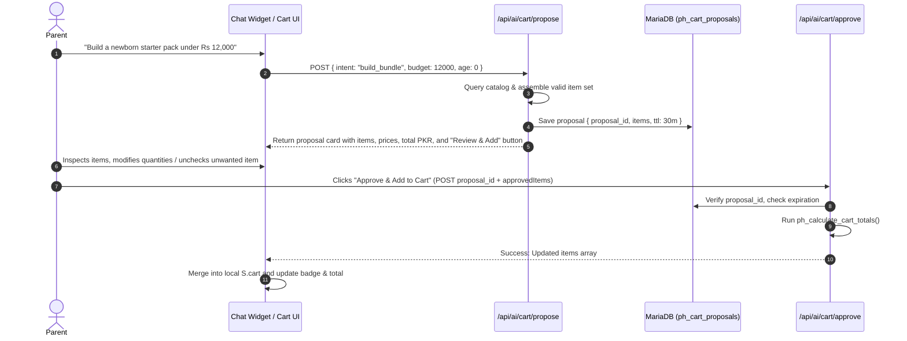

# ParentingHub SmartCart AI — System Architecture & Technical Feasibility Specification

**Project:** ParentingHub — PayPal Hackathon  
**Document:** System Architecture & Technical Feasibility (Phase 2)  
**Date:** 2026-11-03  
**Status:** Approved for Feature Planning & Implementation  

---

## 1. Architectural Strategy & Guiding Principles

The ParentingHub platform is a battle-tested, custom PHP 8.1+ e-commerce platform with a lightweight vanilla JavaScript front controller. To meet hackathon requirements while strictly safeguarding the live codebase and business logic, we adopt an **Additive & Non-Destructive Architecture**:

```
               ┌────────────────────────────────────────────────────────┐
               │                  ParentingHub Client                   │
               │   (Existing Storefront + SmartCart AI Assistant UI)    │
               └───────────────────┬────────────────────────────────┬───┘
                                   │                                │
                Standard APIs      │                                │  New Endpoints
          (Orders, Auth, Catalog)  │                                │  (AI & PayPal)
                                   ▼                                ▼
       ┌──────────────────────────────────────┐  ┌──────────────────────────────────────┐
       │   Existing PHP API & Router Layer    │  │     SmartCart AI & PayPal Routers    │
       │     (backend/router.php, index.php)  │  │  (backend/api/ai/, api/paypal/)      │
       └───────────────────┬──────────────────┘  └──────────────────┬───────────────────┘
                           │                                        │
                           │   ┌────────────────────────────────┐   │
                           └──►│  Shared Pricing & Order Engine │◄──┘
                               │   (backend/api/lib/pricing.php)│
                               └────────────────┬───────────────┘
                                                │
                                                ▼
                               ┌────────────────────────────────┐
                               │     MySQL / MariaDB Database   │
                               │  (products, ph_orders,         │
                               │   ph_payments, ph_cart_proposals│
                               └────────────────────────────────┘
```

### Core Tenets:
1. **Preserve Production Parity**: Do not alter existing table definitions or break backwards compatibility with COD (Cash on Delivery) and Bank Transfer workflows.
2. **Deterministic Grounded AI**: The Large Language Model (LLM) is strictly a reasoning and natural-language interface. It **never generates prices, availability, or product specifications out of thin air**. All data presented to the user is hydrated and validated directly from MySQL.
3. **Zero-Trust Client Pricing**: The client cannot dictate prices, shipping rates, or discounts. The server-side pricing engine calculates and verifies all totals.
4. **Server-Side PayPal Verification**: PayPal orders are created and captured server-side via PayPal Orders v2 REST API. No order is confirmed without authoritative PayPal capture confirmation.
5. **No Production Database Exposure**: All development and testing run against a local MariaDB/MySQL sandbox populated with the 287 verified catalog items from `seed/catalog.json`.

---

## 2. Component Design & Module Architecture

### 2.1 Shared Core Engine: `backend/api/lib/pricing.php`
Currently, `backend/api/index.php` contains ~120 lines of inline cart parsing, option parsing, catalog fetching, and coupon calculations.
To prevent discrepancies between the standard checkout, the AI SmartCart, and PayPal checkout, this logic is modularized into a shared, stateless helper:

- **`ph_calculate_cart_totals(PDO $pdo, array $requestedItems, ?string $couponCode = null): array`**
  - **Inputs**: Array of items `[{id: string, qty: int, option?: string}]`, optional coupon string.
  - **Verification steps**:
    1. Validates line item count (1 to 50 items) and quantities (1 to 99 per item).
    2. Fetches matching records from `products` table via `SELECT ... WHERE id IN (...)`.
    3. Enforces `in_stock = 1`.
    4. Validates option choices (e.g. `Color: Blue`, `Size: 260ml`) against product's `options_json`.
    5. Computes subtotal with 2-decimal precision.
    6. Evaluates active, non-expired coupons from `ph_catalog_state` (min order requirement, percentage or fixed discount).
    7. Applies the store's fixed PKR 200 delivery fee.
  - **Returns**: Standardized dictionary containing validated `items`, `subtotal`, `discount`, `shipping`, `total`, and `appliedCoupon`.

---

### 2.2 SmartCart AI Engine: `backend/api/ai/`

The AI subsystem consists of three modular layers:

```
User Query ──► [ Intent & Entity Extractor ] ──► [ MySQL Catalog Filter & Ranker ] ──► [ LLM Formatter & Explainer ] ──► Sanitized Output
```

#### Layer 1: Query Intent & Entity Extraction
Extracts shopping intents, target child age / developmental stage, budget constraints in PKR, product categories, and explicit product IDs for comparison.

#### Layer 2: Deterministic Catalog Retrieval (Grounded Search)
Queries MySQL using:
- Staged keyword matching and category filters (`products.category`, `products.brand`, `products.tags`).
- Budget filtering: `price <= max_budget`.
- Availability enforcement: `in_stock = 1`.
- Top-K candidate selection (maximum 8 candidates passed into LLM prompt to minimize token latency and prevent hallucination).

#### Layer 3: Reasoning & Explanations (LLM)
Prompts the model with strict system boundaries:
- "You are the ParentingHub SmartCart AI shopping assistant for Pakistani parents."
- "You may ONLY reference the provided candidate products."
- "You must NEVER invent prices, discounts, or stock."
- Returns structured JSON for card rendering, spec comparisons, and cart proposals.

#### Layer 4: Response Hydrator & Verification
PHP parses the LLM output, verifies that every cited product ID exists in the retrieved set, and re-attaches current images, prices, and links before sending to the client.

---

## 3. Detailed API Contracts

### 3.1 AI Assistant Chat & Discovery
`POST /api/ai/assistant`
- **Request Headers**: `Content-Type: application/json`, `X-Requested-With: XMLHttpRequest`
- **Request Body**:
  ```json
  {
    "message": "I need anti-colic feeding bottles for my 3-month-old under Rs 6,000",
    "conversationHistory": [
      {"role": "user", "content": "..."},
      {"role": "assistant", "content": "..."}
    ],
    "context": {
      "childAgeMonths": 3,
      "budget": 6000
    }
  }
  ```
- **Response Body**:
  ```json
  {
    "success": true,
    "reply": "For a 3-month-old baby, Philips Avent Anti-Colic bottles with AirFree vents are designed to reduce air ingestion during feeding.",
    "stage": "Sensory Explorer & Rolling (0-3 Months)",
    "recommendations": [
      {
        "id": "philips-avent-anti-colic-bottle-260ml",
        "name": "Philips Avent Anti-Colic Bottle 260ml",
        "price": 2850.00,
        "compareAt": 3200.00,
        "image": "/assets/uploads/avent_260ml.webp",
        "url": "/product/philips-avent-anti-colic-bottle-260ml",
        "brand": "Philips Avent",
        "inStock": true,
        "rating": 4.9,
        "reason": "Features the AirFree vent that keeps the teat full of milk, not air, for upright feeding."
      }
    ],
    "suggestedActions": [
      {"label": "Compare with Tommee Tippee Closer to Nature", "action": "compare", "productIds": ["philips-avent-anti-colic-bottle-260ml", "tt-closer-to-nature-260ml"]},
      {"label": "Add recommended starter set to Cart", "action": "propose_cart", "productIds": ["philips-avent-anti-colic-bottle-260ml"]}
    ]
  }
  ```

---

### 3.2 Product Comparison Engine
`POST /api/ai/compare`
- **Request Body**:
  ```json
  {
    "productIds": ["philips-avent-anti-colic-bottle-260ml", "tt-closer-to-nature-260ml"]
  }
  ```
- **Response Body**:
  ```json
  {
    "success": true,
    "products": [
      {
        "id": "philips-avent-anti-colic-bottle-260ml",
        "name": "Philips Avent Anti-Colic Bottle 260ml",
        "price": 2850.00,
        "brand": "Philips Avent",
        "category": "Feeding Bottles",
        "keyFeatures": ["AirFree Vent", "BPA Free", "Dishwasher safe"],
        "options": ["Size: 260ml", "Pack: Single"],
        "rating": 4.9
      },
      {
        "id": "tt-closer-to-nature-260ml",
        "name": "Tommee Tippee Closer to Nature 260ml",
        "price": 2650.00,
        "brand": "Tommee Tippee",
        "category": "Feeding Bottles",
        "keyFeatures": ["Breast-like teat", "Anti-colic valve", "Easy latch"],
        "options": ["Size: 260ml"],
        "rating": 4.8
      }
    ],
    "verdict": {
      "summary": "Both are premium anti-colic options. Choose Philips Avent if your baby experiences significant gas or reflux; choose Tommee Tippee if transitioning between breast and bottle feeding."
    }
  }
  ```

---

### 3.3 Permission-Based Smart Cart Workflow
The AI **proposes** a bundle; the user **reviews and approves** before any modification occurs to the actual shopping bag.



- **`POST /api/ai/cart/propose`**: Generates a proposal ticket in `ph_cart_proposals` with a 30-minute expiration.
- **`POST /api/ai/cart/approve`**: Validates the proposal against database stock and price tables, ensuring user approval is explicitly recorded.

---

### 3.4 PayPal Sandbox Integration

#### Currency & FX Conversion Strategy
- **Core Challenge**: ParentingHub prices and records orders in PKR. PayPal does not support PKR as a settlement currency.
- **Technical Solution**:
  1. Base currency remains **PKR**.
  2. For PayPal payments, the server computes the USD equivalent using a configured conversion rate (`PAYPAL_FX_PKR_USD`, e.g., 1 USD = 280 PKR).
  3. The exact exchange rate and calculated USD amount are stored with the order (`ph_orders.total_usd`, `fx_rate`).
  4. Both PKR and USD totals are shown to the parent before they launch PayPal:
     `Total: PKR 8,400 (Approx. $30.00 USD)`.

#### Endpoints:
1. **`POST /api/paypal/create-order`**
   - Validates cart via `ph_calculate_cart_totals()`.
   - Generates high-entropy order ID: `PH-{TIMESTAMP}-{HEX8}` (replaces client-side 5-digit number).
   - Obtains OAuth2 Bearer token from `https://api-m.sandbox.paypal.com/v1/oauth2/token`.
   - Calls `POST /v2/checkout/orders` with:
     - `intent: "CAPTURE"`
     - `purchase_units[0].reference_id: orderId`
     - `purchase_units[0].amount.currency_code: "USD"`
     - `purchase_units[0].amount.value: formattedUsdTotal`
     - `purchase_units[0].custom_id: orderId`
   - Stores initial record in `ph_payments` (status: `CREATED`).
   - Returns PayPal Order ID (`paypalOrderId`) to frontend PayPal SDK.

2. **`POST /api/paypal/capture-order`**
   - Receives `{ orderId, paypalOrderId }`.
   - Verifies session and order ownership.
   - Calls PayPal: `POST /v2/checkout/orders/{paypalOrderId}/capture`.
   - Verifies:
     - PayPal response status is `COMPLETED`.
     - Captured currency is `USD`.
     - Captured amount matches database calculated USD amount.
   - Updates `ph_payments`: status `CAPTURED`, records `capture_id`.
   - Updates `ph_orders`: status `Confirmed`, payment method `paypal`.
   - Triggers order confirmation email and SMS notification.

3. **`POST /api/paypal/webhook`**
   - Receives events: `PAYMENT.CAPTURE.COMPLETED`, `PAYMENT.CAPTURE.DENIED`, `PAYMENT.CAPTURE.REFUNDED`.
   - Calls PayPal validation endpoint (`/v1/notifications/verify-webhook-signature`).
   - Implements idempotent transaction logging into `ph_payment_events`.

---

## 4. Database Schema Migrations (Additive)

To support SmartCart AI and PayPal without touching existing tables, the following additive tables will be managed by `ph_ensure_schema()`:

```sql
-- 1. PayPal Payments Table
CREATE TABLE IF NOT EXISTS ph_payments (
    id BIGINT UNSIGNED AUTO_INCREMENT PRIMARY KEY,
    order_id VARCHAR(32) NOT NULL,
    provider VARCHAR(20) NOT NULL DEFAULT 'paypal',
    paypal_order_id VARCHAR(64) NOT NULL UNIQUE,
    capture_id VARCHAR(64) NULL UNIQUE,
    currency VARCHAR(3) NOT NULL DEFAULT 'USD',
    amount_usd DECIMAL(10,2) NOT NULL,
    amount_pkr DECIMAL(12,2) NOT NULL,
    fx_rate DECIMAL(10,4) NOT NULL,
    status VARCHAR(30) NOT NULL DEFAULT 'CREATED',
    payer_email VARCHAR(190) NULL,
    raw_response LONGTEXT NULL,
    created_at DATETIME NOT NULL DEFAULT CURRENT_TIMESTAMP,
    updated_at DATETIME NOT NULL DEFAULT CURRENT_TIMESTAMP ON UPDATE CURRENT_TIMESTAMP,
    INDEX idx_ph_payments_order (order_id),
    INDEX idx_ph_payments_status (status)
) ENGINE=InnoDB DEFAULT CHARSET=utf8mb4 COLLATE=utf8mb4_unicode_ci;

-- 2. Webhook Event Deduplication Log
CREATE TABLE IF NOT EXISTS ph_payment_events (
    id BIGINT UNSIGNED AUTO_INCREMENT PRIMARY KEY,
    event_id VARCHAR(100) NOT NULL UNIQUE,
    event_type VARCHAR(80) NOT NULL,
    order_id VARCHAR(32) NULL,
    verified TINYINT(1) NOT NULL DEFAULT 0,
    payload LONGTEXT NOT NULL,
    created_at DATETIME NOT NULL DEFAULT CURRENT_TIMESTAMP
) ENGINE=InnoDB DEFAULT CHARSET=utf8mb4 COLLATE=utf8mb4_unicode_ci;

-- 3. Permission-Based AI Cart Proposals Table
CREATE TABLE IF NOT EXISTS ph_ai_cart_proposals (
    proposal_id VARCHAR(64) PRIMARY KEY,
    user_id BIGINT UNSIGNED NULL,
    session_token_hash CHAR(64) NULL,
    items_json LONGTEXT NOT NULL,
    subtotal_pkr DECIMAL(12,2) NOT NULL,
    status ENUM('proposed', 'approved', 'rejected', 'expired') NOT NULL DEFAULT 'proposed',
    expires_at DATETIME NOT NULL,
    created_at DATETIME NOT NULL DEFAULT CURRENT_TIMESTAMP,
    INDEX idx_cart_proposals_expires (expires_at)
) ENGINE=InnoDB DEFAULT CHARSET=utf8mb4 COLLATE=utf8mb4_unicode_ci;

-- 4. Rate Limiting Table
CREATE TABLE IF NOT EXISTS ph_rate_limits (
    bucket_key VARCHAR(120) PRIMARY KEY,
    hits INT UNSIGNED NOT NULL DEFAULT 1,
    reset_at INT UNSIGNED NOT NULL,
    INDEX idx_rate_reset (reset_at)
) ENGINE=InnoDB DEFAULT CHARSET=utf8mb4 COLLATE=utf8mb4_unicode_ci;
```

---

## 5. UI/UX Design System Specifications

The SmartCart AI interface will strictly adhere to ParentingHub's brand identity:

- **Color Tokens**:
  - Primary Pink: `#B63866`
  - Deep Berry: `#972B53`
  - Soft Pastels: `#FDF5F8`, `#FCEBF0`
  - Supporting Accent Lavender: `#8E6FC4`
  - Background: Cream `#FAF6F4`
  - Borders: `#EEE4EB`
- **Typography**:
  - Headings: *Playfair Display*
  - Body & Controls: *Plus Jakarta Sans*
  - Badges & Accents: *Fredoka*
- **Component Deliverables**:
  - **SmartCart AI Dock / Modal**: A docked responsive drawer that integrates smoothly on mobile and desktop without obstructing standard navigation.
  - **Interactive Recommendation Cards**: Micro-cards displaying real product photos, genuine PKR prices, in-stock badges, quick-compare toggles, and "Add to Proposed Cart" buttons.
  - **Side-by-Side Product Comparison Drawer**: Responsive matrix highlighting price differences, age recommendations, and material specs.
  - **Proposed Cart Review Sheet**: Interactive confirmation UI requiring the parent to review every proposed item before adding to their cart.
  - **PayPal Button Container**: Hosted PayPal SDK buttons rendered inside the existing checkout modal with clear PKR-to-USD conversion explanations.

---

## 6. Technical Feasibility Matrix

| Requirement | Feasibility | Technical Approach | Notes / Mitigations |
|---|---|---|---|
| Natural Language Shopping Query | **100% Feasible** | Server-side Gemini API with structured JSON output | Schema-driven entity extraction; fallback to keyword search if API times out |
| Factual Product Recommendations | **100% Feasible** | SQL candidate pre-filtering + LLM ranking | LLM can only select from retrieved database IDs |
| Product Comparison | **100% Feasible** | Database column matrix + AI summary | Zero hallucination on specs/prices |
| Permission-Based Smart Cart | **100% Feasible** | Server-side proposal tickets (`ph_ai_cart_proposals`) | User must click "Approve" before cart mutation |
| PayPal Sandbox Integration | **100% Feasible** | PayPal Orders v2 REST API via PHP cURL | Client never authorizes payments directly |
| PKR to USD Currency Conversion | **100% Feasible** | Server-side configured rate with breakdown display | Transparent conversion rate displayed on checkout |
| Backwards Compatibility | **100% Feasible** | Extracted shared pricing engine | Existing COD, Bank Transfer, and Admin orders remain intact |
| Local Database Isolation | **100% Feasible** | Local MariaDB initialized from `catalog.json` | Zero connection to live production cPanel DB |

---

## 7. Next Steps

With Phase 1 (Audit) and Phase 2 (Architecture & Feasibility) documented, the roadmap advances to:
- **Phase 3**: Hackathon Feature Planning & Task Breakdown.
- **Phase 4**: Local Database and Shared Pricing Engine Integration.
- **Phase 5**: SmartCart AI Assistant Backend & Frontend implementation.
- **Phase 6 - 8**: Recommendations, Comparisons, Permission Cart, and PayPal Sandbox.
- **Phase 9 - 11**: UI polish, Security testing, and Demo documentation.

