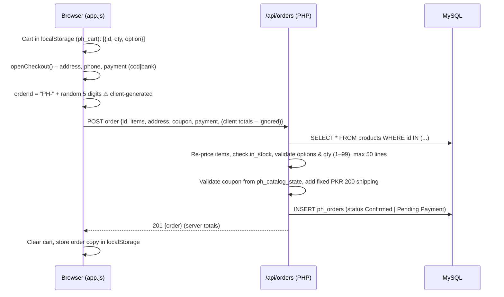
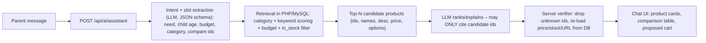
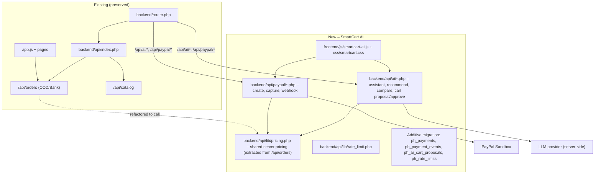

# ParentingHub — Hackathon Technical Audit (Phase 1)

| | |
|---|---|
| **Project** | ParentingHub SmartCart AI (PayPal Hackathon) |
| **Phase** | 1 — Existing project inspection (no implementation) |
| **Audit date** | 2026-11-03 |
| **Source** | `admin-panel (3).zip` (118,855,236 bytes, 8,141 entries) |
| **ZIP SHA-256** | `20864290B5545AE7329F2EDAD3EE91EE69F270FA6B966AAD405E3CFA9FA30CAD` |
| **Reference copy** | `parentinghub-original/` (extracted read-only reference; ZIP preserved untouched) |

> **No original files were modified. No code was executed from the archive** (the only action was `php -l` syntax checks). Nothing connected to a database, cPanel, or the live site. All credentials found are reported **only as "present"** and their values are never shown.

---

## 0. Executive Summary

ParentingHub is a **hybrid platform**:

1. A **custom PHP 8.1+ commerce application** (front controller + JSON REST API + server-rendered pages + a large vanilla-JS SPA layer). This runs the live storefront, cart, checkout, accounts, community, reels, and admin.
2. A **WordPress 7.1.4 staging install** at `/wp-build` with a custom theme `parentinghub-hybrid` and plugin `parentinghub-content`. It handles Learn/Blog content and is *not* yet the public root.

Both use **MySQL/MariaDB** (export from MariaDB 10.11). The commerce DB and the WordPress DB are separate.

**Verdict on hackathon feasibility: strong.** The existing order API already **recomputes prices, stock, options, coupons, and shipping on the server** and ignores browser totals. That is the right base for both a permission-based AI cart and PayPal. AI and PayPal can be added as **new, additive API routes and one new frontend module**, without rewriting anything.

**Top blockers and risks**

| # | Item | Severity |
|---|---|---|
| 1 | Real production secrets ship inside the ZIP (`backend/.env`, `wp-build/wp-config.php`) | 🔴 Critical |
| 2 | The full DB dump `database/parentinghub_database.sql` is **not in the ZIP**, and the `products` table DDL is missing | 🔴 Blocker for local DB |
| 3 | **PayPal does not support PKR**, so a currency-conversion strategy is required | 🟠 Design |
| 4 | PayPal merchant availability for a Pakistan-based business must be confirmed (Sandbox works regardless) | 🟠 Business |
| 5 | Order IDs are generated in the browser (`PH-` + 5 random digits) | 🟠 Must fix before PayPal |
| 6 | Coupon codes are publicly exposed through `/api/catalog` and `/js/data.js` | 🟠 High |

---

## 1. Project Directory Structure

```text
(ZIP root = cPanel public_html)
├── index.php                  # Front controller → defines PH_ENTRY, requires backend/router.php
├── router.php                 # Local dev shim:  php -S 127.0.0.1:8080 router.php
├── .htaccess                  # Rewrites everything → index.php; bypasses /wp-build; real files served directly
├── wp-home-categories.php     # Read-only JSON bridge (categories) for WordPress homepage
├── error_log                  # ⚠ Production PHP error log (229 KB) shipped in archive
├── *.txt / *.md               # ~20 release notes, deploy notes, lint results (PHP_LINT_RESULTS.txt)
│
├── backend/                   # 🔒 Denied over HTTP (.htaccess + router rule)
│   ├── .env                   # ⚠ REAL credentials present (see §10)
│   ├── .env.example
│   ├── router.php             # Main router: security checks, static assets, API dispatch, page templates
│   ├── MIGRATION-MAP.json
│   ├── config/routes.json     # ~1,350 URL → template mappings (incl. static product/category pages)
│   ├── config/legacy-routes.json  # 301/410 legacy URL rules
│   └── api/
│       ├── bootstrap.php      # Env loader, CORS/CSRF, PDO, schema/migrations, sessions, auth helpers
│       ├── index.php          # ~1,500-line JSON REST API (all /api/* routes)
│       ├── milestone.php      # Existing "AI Parenting Advisor" (n8n webhook + rule-based fallback)
│       ├── frontend-data.php  # Generates /js/data.js dynamically from MySQL
│       ├── db-status.php      # Admin-only DB diagnostics
│       ├── source-image.php   # Allow-listed image fetcher (tommeetippee.pk, philipsaventpakistan.com)
│       ├── sitemap.php
│       ├── seed/catalog.json  # 8 MB seed: 287 products, categories, brands, settings, FAQs, homeData
│       ├── cache/             # .schema_installed marker, source-images cache
│       └── *.json             # Empty legacy stores (orders.json, inquiries.json… all "[]")
│
├── admin-panel/
│   ├── index.php              # 143 KB single-file admin SPA (requires PH_ENTRY)
│   └── index_categories_crud.php  # ⚠ Byte-identical duplicate of index.php
│
├── frontend/                  # 🔒 Not directly addressable; router serves allow-listed static types
│   ├── css/style.css          # 181 KB design system (light + dark theme tokens)
│   ├── js/app.js              # 157 KB SPA logic: cart, checkout modal, community, auth chrome
│   ├── js/milestone-ai.js     # Floating AI assistant widget (used on home/shop/product/profile)
│   ├── js/community-db.js, data.js (stub; real data.js is generated)
│   ├── assets/ (379 files), art/ (28 images), logo, icons, manifest
│   └── pages/
│       ├── index, shop, product, cart, track, login, profile, edit-profile, saved,
│       │   community, reels, articles, about, support, returns, privacy, terms, post, edit .php
│       ├── product/  (427 files – legacy per-product folders; product URLs now route to product.php)
│       └── shop/     (220 files – legacy category/brand folders)
│
├── database/                  # 🔒 Denied over HTTP
│   ├── README_DATABASE.txt, README_SAFE_DEPLOYMENT.txt, CURRENT_DATABASE_RECOVERY.txt …
│   ├── verify_database.sql            # Read-only post-import checks
│   ├── product_image_quality_patch_safe.sql
│   └── seo_article_repair_safe.sql
│   ✖ parentinghub_database.sql        # REFERENCED BY DOCS BUT NOT INCLUDED
│
├── docs/                      # Developer audit/fix notes dated 2026-10-30
│
├── wp-build/                  # WordPress 7.1.4 staging (own .htaccess, own DB)
│   ├── wp-config.php          # ⚠ REAL WordPress DB credentials + salts present
│   ├── wp-admin.zip           # ⚠ 38.9 MB archive left in web root
│   ├── error_log              # ⚠ 42 KB
│   └── wp-content/
│       ├── themes/parentinghub-hybrid
│       └── plugins/ akismet, imunify-security, parentinghub-content, seo-by-rank-math
│
└── ParentingHub-*-PATCH-v5 / SAFE-FIX-v6 / POLISH-v10/   # ⚠ Leftover patch folders in web root
```

**Extraction note:** 5 of 6,610 files could not be written because their paths exceed the Windows 260-character limit. All 5 are minified UI bundles inside the third-party `wp-build/wp-content/plugins/imunify-security/` plugin, so they do not affect the commerce app. They are listed in the scratch log.

---

## 2. Frontend Technology

| Aspect | Finding |
|---|---|
| Rendering | Server-rendered PHP templates (`frontend/pages/*.php`) plus a client-side vanilla-JS layer. No framework, no bundler, no `package.json`. |
| JS | `app.js` (3,071 lines) builds the header/footer chrome (`#chrome-top/#chrome-bottom`), renders product grids, cart, checkout modal, community, and auth state. |
| Data | `/js/data.js` is **generated per request** from MySQL. It emits globals: `PRODUCTS`, `CATEGORIES`, `BRANDS`, `SETTINGS`, `HOMEDATA`, `ARTICLES`, `FAQS`, `COUPONS`. |
| State | `localStorage` keys with prefix `ph_` (cart, orders history, customer_info, user, theme, wishlist mirror). |
| Escaping | A global `esc()` HTML-escapes 5 characters. It is used widely, but a few template sinks skip it (see §10). |
| Fonts | Google Fonts: **Playfair Display** (headings), **Plus Jakarta Sans** (UI), **Fredoka** (playful accents). |
| Theming | Light + dark theme via CSS custom properties; `theme-color #bd3d6b`. |
| PWA | `manifest.webmanifest`, 192/512 icons. |
| Existing AI UI | `milestone-ai.js` is a floating chat widget with an email gate, typing indicator, and safe-HTML rendering, already loaded on **home, shop, product, profile**. |

### Brand tokens (from `style.css :root`)

| Token | Value | Use |
|---|---|---|
| `--primary` / `--pink` | `#B63866` (dark `#972B53`, light `#C94877`) | Primary rose-pink |
| `--accent` | `#8E6FC4` | Lavender |
| `--pink-soft` / `--pink-light` | `#FDF5F8` / `#FCEBF0` | Pastel surfaces |
| `--cream` | `#FAF6F4` | Page background |
| `--ink` / `--ink-2` | `#2E2333` / `#6A5B6F` | Text |
| `--green` | `#2F9E5B` | Success |

> [!NOTE]
> The brief describes the brand as **pink + blue**. The current stylesheet has **no blue token**: its palette is rose-pink plus lavender on cream/white. The SmartCart AI UI should reuse these tokens. Any blue (for example a soft baby-blue for AI/assistant accents or the PayPal area) needs your approval before it is introduced.

---

## 3. Backend Technology

| Aspect | Finding |
|---|---|
| Language | PHP with `declare(strict_types=1)`. It uses `never` return types and `str_starts_with`, so it needs **PHP ≥ 8.1** (docs agree). |
| Architecture | Single front controller → `backend/router.php` → either `/api/*` → `backend/api/index.php` (one large if-chain router) or a page template from `routes.json`. |
| DB access | **PDO** (`pdo_mysql`), `ERRMODE_EXCEPTION`, `EMULATE_PREPARES=false`, `utf8mb4`. Prepared statements are used consistently. |
| Config | Custom `.env` loader (`backend/.env`, then the parent directory). |
| Dependencies | **None.** No Composer and no `vendor/`. Uses `curl`, `mbstring`, `json`, `fileinfo`, `openssl`, `pdo_mysql`. |
| Migrations | Run **automatically at request time** inside `ph_pdo()` → `ph_ensure_schema()`. They are additive (`CREATE TABLE IF NOT EXISTS`, marker rows in `ph_catalog_state`). |
| Email/SMS | PHP `mail()` for order confirmation and password reset; optional `ORDER_SMS_WEBHOOK_URL`. |
| Server | Apache + `mod_rewrite` (cPanel). `.htaccess` denies `backend/`, `database/`, `frontend/pages/`. |
| Lint | `php -l` with **PHP 8.2.12** (local XAMPP) on all **32 custom PHP files**: **0 errors**. The bundled `PHP_LINT_RESULTS.txt` reports 692 OK. |

> [!WARNING]
> Because migrations run automatically on the first DB connection, **pointing a local copy at the live database would write to it**. This is another reason the hackathon build must only ever use a local or sandbox database.

---

## 4. Database Structure

### 4.1 What could be verified

**Tables created by code (`ph_ensure_schema`)**: `ph_users`, `ph_sessions`, `ph_catalog_state`, `ph_orders`, `ph_inquiries`, `ph_password_resets`, `ph_community_posts`, `ph_community_answers`, `ph_newsletter_subscribers`. Migrations also reference community/reels/saved/wishlist tables (`ph_community_categories`, `ph_community_reels`, …).

**Key schemas**

| Table | Important columns |
|---|---|
| `ph_users` | `id` BIGINT PK, `public_id` UNIQUE, `email` UNIQUE, `password_hash`, `role ENUM('parent','admin')`, `profile_json`, `email_verified`, `is_banned` |
| `ph_sessions` | `token_hash CHAR(64)` PK (SHA-256 of cookie token), `user_id` FK, `expires_at` |
| `ph_orders` | `id VARCHAR(32)` PK, `user_id` FK NULL, `status`, `payment VARCHAR(20)`, `subtotal/shipping/discount/total DECIMAL(12,2)`, `coupon`, `address_json`, `items_json` (full price snapshot) |
| `ph_catalog_state` | `state_key` PK, `payload LONGTEXT`. Holds settings, homeData, FAQs, **coupons**, categories, brands, and migration markers |

**`products` table**: created by the missing SQL dump, **not** by code. Columns inferred from the admin upsert statement:
`id, sku, name, price, compare_at, image, images(JSON), category, brand, description, has_options, options_json, rating, reviews, in_stock, weight_kg, tags(JSON), source_url, video_url, source_json, updated_at`

**Other tables referenced but not defined in code**: `articles`, `site_settings`, `legacy_products_archive` (140 rows), and per the docs "31 original application tables". The docs also mention **3 triggers** (`ph_catalog_products_after_insert/update/delete`) that sync `ph_catalog_state` → `products`.

### 4.2 Catalog data (from `seed/catalog.json`)

| Metric | Value |
|---|---|
| Products | **287** (docs confirm 287 live) |
| In stock | 287 (`in_stock` is a **boolean flag only**; there are **no stock quantities**) |
| Price range | PKR 210 – 160,000 (avg ≈ 10,991) |
| With options (size/age/colour) | 86 |
| Avg description length | ≈ 288 characters |
| Brands | Tommee Tippee 119 · Philips Avent 90 · Kidilo 45 · ParentingHub Gear 21 · Mastela 7 · Power Weelz 2 · Huanger 2 · Sobebear 1 |
| Categories (20) | Soothing 58, Pacifiers 23, Feeding Bottles 23, Baby Swings & Bouncers 18, Accessories 18, Bottle Feeding 18, Cup & Weaning 17, Teats 14, Ride-On & Scooters 14, High Chairs 13, Electricals 11, Breast Feeding 11, Baby Strollers 9, Playards & Cribs 8, Baby Toys & Activity 8, Car Seats & Carry Cots 7, Gift Sets 6, Breast Care 6, Non-Spill Cups 4, Baby Bath & Care 1 |

This data is **well suited to grounded AI**: names, categories, brands, descriptions, tags, options, ratings, and prices are structured and limited in number (287 products fit comfortably in a retrieval step).

### 4.3 ❗ Missing information

- `database/parentinghub_database.sql` (full schema + data) is **not in the ZIP**. Without it, the exact DDL for `products`, `articles`, `site_settings`, the triggers, and the 31 legacy tables **cannot be verified**.
- **Whether the live DB matches this snapshot is unknown.**

---

## 5. Existing Features (verified in code)

| Area | Features |
|---|---|
| Storefront | Home, Shop (category/brand filters, `/shop/categories/{slug}`, `/shop/brands/{slug}`), Product detail `/product/{id}` (DB-backed), wishlist, search |
| Cart & Checkout | localStorage cart, cart page, checkout modal, coupons, fixed PKR 200 delivery, **COD** and **Bank Transfer/Raast** |
| Accounts | Register, login, logout, Google OAuth (auth-code flow + token endpoint), forgot/reset password, profile and children data (growth, milestones, vaccines), "My Space" |
| Orders | Server-validated order creation, customer order list, admin status workflow, email + optional SMS notification |
| Community | Posts, answers (threaded), votes, best/verified answers, saved items, reels (upload, like, comment) |
| Content | Learn articles (DB), WordPress Learn/Blog staging, user-submitted blogs (moderated) |
| AI | **Milestone advisor**: optional n8n webhook (`AI_ADVISOR_WEBHOOK_URL`) with a rule-based, age-staged fallback. Store recommendations are **generic text and not linked to real products**. |
| Admin | Catalog CRUD (bulk save to MySQL), categories/brands, orders, users, inquiries, community moderation, reels, media upload (images/video ≤ 80 MB), theme/home CMS, Learn articles |
| SEO | Dynamic sitemap, canonical redirects, legacy 301/410 rules, noindex on private routes, Rank Math (WP) |

---

## 6. Existing Authentication System

- **Not PHP sessions.** `session_start()` is never used. Auth is a **custom DB-backed token session**:
  - Login creates `random_bytes(32)` → cookie `ph_session` (HttpOnly, `Secure` when HTTPS, `SameSite=Lax`, 30 days by default). Only the **SHA-256 hash** is stored in `ph_sessions`.
  - `ph_require_user()` / `ph_require_admin()` enforce authorization server-side on every protected API route.
- Passwords use `password_hash(PASSWORD_DEFAULT)` (bcrypt), with a minimum length of 8.
- Admin login: `/api/auth/admin-login`. The admin SPA shell loads for anyone, but **all admin data/API calls are server-gated** by `ph_require_admin`.
- Private pages (`/profile`, `/saved`, …) are gated server-side in `router.php`.
- **CSRF model:** every POST/PUT/PATCH/DELETE must carry `X-Requested-With: XMLHttpRequest` and an allow-listed `Origin`, combined with `SameSite=Lax` cookies. This is reasonable for a JSON API because the custom header forces a CORS preflight.
- Google OAuth uses a `state` cookie. Admin accounts are blocked from social login.

Weaknesses are listed in §10.

---

## 7. Existing Shopping Cart & Checkout Architecture



**Strengths (already secure):** the server never trusts client prices, discounts, shipping, or totals, and it validates product IDs, stock flags, quantities, and option values against the DB. This logic can be **reused as the single pricing function** for both the AI cart and PayPal.

**Gaps relevant to PayPal:**
- Order ID is client-generated with only **90,000 possibilities**, so collisions (409) and guessability are realistic.
- `payment` only knows `cod` and `bank`. `ph_order_from_row()` maps anything that is not `bank` to "Cash on Delivery".
- There is no payment-transaction table, no provider reference, and no idempotency key.
- The client reads `data.error` while the server returns `message`, so users see a generic error instead of the real reason (minor bug).
- **Order tracking (`/track`) reads only from localStorage**. There is no server lookup for guests.
- Cart lives only in localStorage (not tied to the account).

---

## 8. Existing Order Management

- Statuses (admin PATCH allow-list): `Pending Payment`, `Confirmed`, `Packed`, `Shipped`, `Out for Delivery`, `Delivered`, `Cancelled`.
- Initial status: COD → `Confirmed`; Bank → `Pending Payment`.
- Admin: list (≤ 5,000), status update, **hard delete**. Customer: own orders (≤ 500).
- `items_json` stores a full product snapshot at purchase time, so historical orders survive catalog changes.
- No audit trail of status changes, no refunds, no payment reconciliation.

---

## 9. Existing API Integrations

| Integration | Status |
|---|---|
| Google OAuth 2.0 | Implemented. Credentials configured in `.env`. |
| n8n AI advisor webhook | Optional (`AI_ADVISOR_WEBHOOK_URL`); **not set** in the shipped `.env`, so the rule-based fallback is used |
| Order SMS webhook | Optional (`ORDER_SMS_WEBHOOK_URL`); not set |
| PHP `mail()` | Order confirmation, password reset |
| Source image fetcher | Allow-listed hosts only (good SSRF control) |
| DiceBear avatars | External avatar URLs |
| WordPress ↔ PHP bridges | `/api/wp-home-products`, `/api/wp-learn-articles`, `wp-home-categories.php` |
| **Payment gateways** | **None.** No PayPal, Stripe, JazzCash, or Easypaisa code exists. |
| **LLM provider** | **None directly.** Only the optional n8n webhook. |

---

## 10. Security Concerns

Severity reflects risk to the **production** site. Items marked 🛠 must be resolved within the hackathon scope.

| # | Severity | Finding | Location |
|---|---|---|---|
| S1 | 🔴 Critical | **Real secrets are inside the ZIP**: production DB name/user/password, admin bootstrap email/password, Google OAuth client secret (`backend/.env`), and the WordPress DB credentials + auth salts (`wp-build/wp-config.php`). If this ZIP has been shared, uploaded, or emailed, **rotate all of them**. | `backend/.env`, `wp-build/wp-config.php` |
| S2 | 🟠 High | **The admin bootstrap password is a permanent backdoor.** Login accepts `ADMIN_BOOTSTRAP_PASSWORD` for *any* admin account even after the admin changes their password, then silently re-hashes it into the DB. | `api/index.php` L586-595 |
| S3 | 🟠 High 🛠 | **All coupon codes are public** via `GET /api/catalog` and the generated `/js/data.js` (`COUPONS`). | `index.php` L183, `frontend-data.php` L130-132 |
| S4 | 🟠 High 🛠 | **No rate limiting** on login, register, forgot-password, order creation, or the AI endpoint. This allows brute force, spam orders, and (once an LLM is added) **cost abuse**. | API-wide |
| S5 | 🟠 High 🛠 | **Client-generated, low-entropy order IDs** (`PH-` + 5 digits). Must be server-generated before payments are linked. | `app.js` L1411 |
| S6 | 🟡 Medium | `?migrate=1` on **any** request forces the full schema/migration/seed path for unauthenticated callers (load/DoS; unexpected writes). | `bootstrap.php` L568 |
| S7 | 🟡 Medium | Users can set `isVerified`, `followersCount`, `followingCount` on their own profile (trust spoofing). | `index.php` L624 |
| S8 | 🟡 Medium | Admin catalog save **deletes every product not in the payload**. A truncated or partial request could wipe the catalog. | `index.php` L219-220 |
| S9 | 🟡 Medium | No `Content-Security-Policy` or `Strict-Transport-Security` headers. | `bootstrap.php`, `.htaccess` |
| S10 | 🟡 Medium | Password-reset tokens are stored **in plaintext** (sessions are hashed; resets are not). | `index.php` L688-692 |
| S11 | 🟡 Medium | **Live bug**: the regex on `product.php` line 40 fails to compile (escaped `]`). The unsafe-character URL check is skipped, and **1,089 warnings** were logged in 3 days. | `frontend/pages/product.php` L40 |
| S12 | 🟡 Medium | Root `.htaccess` serves any real file, so `error_log`, `wp-build/error_log` (server paths), release notes, `wp-admin.zip` (38.9 MB), the duplicate admin file, and **leftover patch folders with PHP files** are web-reachable. The stale `PATCH-v5/backend/api/index.php` would probably fatal on a missing `bootstrap.php` (not executed to confirm). | web root |
| S13 | 🟢 Low | DOM-XSS sinks: `cart.php` renders `src="${p.image}"` unescaped and injects `it.id` (from localStorage) into inline `onclick`. The data is admin- or self-controlled, so risk is low, but it should be hardened. | `cart.php` L120, L126-130 |
| S14 | 🟢 Low | `milestone.php` hard-codes `Access-Control-Allow-Origin: https://www.parentinghub.pk`, overriding the central CORS policy. | `milestone.php` L6 |
| S15 | 🟢 Low | Inline `style=`/`onclick=` everywhere makes a strict CSP hard to adopt later. | frontend |

**Positive controls already in place:** prepared statements throughout (no SQL injection found in reviewed paths), hashed session tokens, HttpOnly/SameSite cookies, server-side pricing, option validation, upload MIME sniffing via `finfo` with random filenames and no executable types, path-traversal checks in the router, an SSRF allow-list, non-enumerating forgot-password, and denial of `backend/` and `database/` over HTTP.

---

## 11. Missing Dependencies / Missing Information

| Item | Status | Impact |
|---|---|---|
| `database/parentinghub_database.sql` | ❌ Missing from ZIP | Cannot build a faithful local DB (no `products`/`articles`/`site_settings` DDL, triggers, users, orders). |
| Local PHP | ✅ XAMPP **PHP 8.2.12** at `C:\xampp\php` (curl, pdo_mysql, mbstring, openssl, fileinfo, json OK) | Not on PATH; must be called by full path. |
| Local DB | ✅ XAMPP **MariaDB 10.4.32**. ⚠ Docs say the dump uses MariaDB 10.11 but `verify_database.sql` is 10.4-compatible. | Import compatibility must be tested once the dump is supplied. |
| Composer / vendor | Not used | None. PayPal can be integrated via raw REST + cURL (official REST API), so **no SDK is required**. |
| Node.js / Git | ✅ Installed | Optional (tests and tooling only). |
| Docker | Not installed | Not required. |
| Workspace git repo | ❌ Not initialised | Recommended before Phase 4 so every change is tracked and reversible. |
| PayPal Sandbox credentials | ❌ Not provided | Needed for Phase 8 (Client ID + Secret from developer.paypal.com, sandbox app). |
| LLM API key | ❌ Not provided | Needed for Phase 5 (provider to be chosen). |
| Live/production parity | Unknown | It is unknown whether the ZIP equals the current live site. |

---

## 12. How AI Can Be Integrated

### Design principle: **Retrieve → Reason → Verify**

The LLM never sees or produces "truth" on its own. PHP retrieves real candidates from MySQL, the LLM reasons only over those candidates and returns **product IDs plus explanations in strict JSON**, and PHP **re-hydrates every price, stock flag, image, and URL from the DB** before anything reaches the browser.



| Feature | Approach on the existing stack |
|---|---|
| **A. Shopping assistant** | Extend the existing `milestone-ai.js` floating widget (already on home/shop/product/profile) into **SmartCart AI** mode, or add a dedicated `/assistant` page. Backend adds a new `/api/ai/*` route group in `backend/api/` (a separate file such as `ai.php`, dispatched the same way `milestone.php` is). |
| **B. Recommendations** | 287 products need no vector DB. Use SQL filtering (category, price ≤ budget, `in_stock=1`) plus PHP keyword/tag scoring, then LLM ranking and explanation. Unavailable products are labelled as unavailable, never recommended as buyable. |
| **C. Comparison** | `POST /api/ai/compare {ids[]}`. The server builds a **factual table directly from DB columns** (price, brand, category, options, rating, description facts). The LLM only writes a short "which suits whom" summary bounded to those facts. |
| **D. Permission-based cart** | The AI returns a **cart proposal** `{proposal_id, items:[{id, qty, option}]}` stored server-side with a TTL. The UI shows a review sheet with checkboxes/qty. Only on an **explicit user click** does `POST /api/ai/cart/approve` revalidate everything through the same pricing function as `/api/orders` and return the approved lines to add to the cart. The AI has **no access** to payment endpoints. |
| Guardrails | JSON-schema output, ID allow-list, price/stock never taken from LLM text, a medical-advice disclaimer (reusing the existing `safety_note` pattern), prompt-injection resistance (product text treated as data), max input length, **per-IP/per-user rate limit**, and a server-side timeout with a rule-based fallback. |
| Provider | Server-side REST via the existing `ph_http_json()` / cURL. API key lives in `.env` only. A thin provider adapter keeps the LLM swappable. **Gemini API** is a natural candidate (structured JSON output, function calling) but the choice is yours. |
| Observability | Log `ai_sessions` / `ai_messages` (no PII beyond what's needed) for demo analytics and debugging. |

---

## 13. How PayPal Can Be Integrated

### Recommended: **PayPal Orders v2 REST API + PayPal JS SDK buttons**, with server-side create and capture

```mermaid
sequenceDiagram
    participant B as Browser
    participant S as PHP API
    participant DB as MySQL
    participant PP as PayPal Sandbox (api-m.sandbox.paypal.com)
    B->>S: POST /api/paypal/create-order {cart, address}  (no prices)
    S->>S: Server-generate order id, reuse /api/orders pricing (PKR)
    S->>S: Convert PKR→USD with server-side configured rate, round 2dp
    S->>DB: INSERT ph_orders (status 'Pending Payment', payment 'paypal')
    S->>PP: POST /v1/oauth2/token (client_credentials)
    S->>PP: POST /v2/checkout/orders (intent CAPTURE, amount + breakdown, custom_id/invoice_id = PH order id, PayPal-Request-Id)
    PP-->>S: paypal_order_id
    S->>DB: INSERT ph_payments (paypal_order_id UNIQUE, amount, currency, status CREATED)
    S-->>B: {paypal_order_id}
    B->>PP: Buyer approves in PayPal popup
    B->>S: POST /api/paypal/capture {paypal_order_id}
    S->>DB: Lock payment row (SELECT ... FOR UPDATE); reject if already captured
    S->>PP: POST /v2/checkout/orders/{id}/capture (PayPal-Request-Id)
    PP-->>S: status COMPLETED, capture id, amount
    S->>S: Verify status, amount, currency, invoice_id match DB
    S->>DB: ph_payments → CAPTURED (capture_id UNIQUE); ph_orders → 'Confirmed'
    S-->>B: Verified result → success page
    PP-->>S: Webhook PAYMENT.CAPTURE.COMPLETED / DENIED / REFUNDED
    S->>PP: POST /v1/notifications/verify-webhook-signature
    S->>DB: Idempotent reconcile by event id
```

| Requirement | How it will be met |
|---|---|
| Sandbox only | `PAYPAL_ENV=sandbox` → `https://api-m.sandbox.paypal.com`. Live mode is gated behind an explicit config flag and **will not be enabled without your authorization**. |
| Server-side create & capture | New routes `POST /api/paypal/create-order` and `POST /api/paypal/capture`. The JS SDK only renders buttons and calls these. |
| Amount validation | Reuse the existing server pricing (extract it into a shared function, with no behaviour change for COD/bank). Compare the capture response amount and currency to the stored values. |
| Payment verification | Success comes only from the **server capture response** (`COMPLETED`) plus webhook reconciliation, never from the browser callback. |
| Credentials | `PAYPAL_CLIENT_ID`, `PAYPAL_CLIENT_SECRET`, `PAYPAL_WEBHOOK_ID` in `.env` (placeholders in `.env.example`). The secret never reaches the browser. |
| Duplicate prevention | `PayPal-Request-Id` idempotency header, UNIQUE keys on `paypal_order_id` / `capture_id` / webhook `event_id`, row locking, and a state machine that rejects re-capture. |
| Order status | `Pending Payment` → `Confirmed` (paid) / `Payment Failed` / `Refunded`. This adds a `paypal` payment value and fixes the `ph_order_from_row` label mapping. |
| Error handling | Map `INSTRUMENT_DECLINED` (let the buyer retry with another funding source), `ORDER_NOT_APPROVED`, timeouts (reconcile via `GET /v2/checkout/orders/{id}`), and webhook retries. |
| Webhooks | Signature verified through PayPal's verify-webhook-signature API. Needs a public HTTPS URL; for the local demo use the PayPal webhook simulator or a tunnel. |

### ⚠ Currency: PKR is not a PayPal-supported currency

The store prices everything in **PKR**, and PayPal cannot charge in PKR. Options:

1. **(Recommended for the hackathon)** Charge in **USD**, converted server-side from the authoritative PKR total using a configured rate (`PAYPAL_FX_PKR_USD`, stored on the order for audit). Show both amounts to the buyer before approval.
2. Maintain separate USD prices per product (more admin work and data drift).

### ⚠ Business availability

PayPal's merchant availability for a **Pakistan-based business** must be confirmed against PayPal's current country list before any production use. **This does not block the hackathon**: Sandbox accounts work regardless. Production would likely require a business entity and account in a PayPal-supported country. This is flagged for your decision, not assumed.

---

## 14. Potential Compatibility Issues

| Issue | Detail / mitigation |
|---|---|
| MariaDB version | Dump from 10.11, local XAMPP is 10.4.32. JSON functions are fine (`verify_database.sql` avoids `JSON_TABLE`), but collations/DDL must be tested on import. |
| Missing DB dump | Blocks a faithful local environment (see §16, decision D1). |
| `php -S` routing | `router.php` supports the built-in server, but `.htaccess` rules (WP bypass, denies) do **not** apply under `php -S`. That is acceptable for local dev but must be remembered in QA. |
| Auto-migrations | Will run against whatever DB `.env` points to. Use a dedicated local `.env`; never copy the production `.env`. |
| WordPress staging | Has its own DB and needs a WP DB dump to run locally. **Not required** for SmartCart AI (commerce lives in the PHP app). Recommend leaving `/wp-build` out of local scope. |
| Huge single files | `api/index.php` (1.5k lines), `app.js` (3k lines), `admin-panel/index.php` (143 KB). Add new code in **new files** to minimise merge risk and keep existing behaviour stable. |
| No stock quantities | `in_stock` is boolean, so the AI cannot claim "only 3 left". Messaging must say "In stock" / "Currently unavailable" only. |
| Shared hosting limits | cPanel `max_execution_time` and outbound cURL: set LLM timeouts to about 20–25 s with a fallback. Synchronous PayPal calls are fine. |
| Cache busting | Assets use `?v=5.5-product-visual`. New assets need their own version strings. |
| Windows path length | 5 imunify-security plugin files could not be extracted locally (irrelevant to scope). |
| `CORS_ALLOWED_ORIGINS` | Non-production or `APP_DEBUG=1` adds localhost origins automatically, which is convenient for local dev. |

---

## 15. Recommended Hackathon Architecture

**Principle: additive, isolated, reversible.** Existing files change only where integration is unavoidable, and every such change is listed and reviewed.



**Proposed new tables (additive only):**
- `ph_payments` (`id`, `order_id` FK, `provider`, `provider_order_id` UNIQUE, `capture_id` UNIQUE, `amount`, `currency`, `amount_pkr`, `fx_rate`, `status`, `raw_json`, timestamps)
- `ph_payment_events` (`event_id` UNIQUE, `type`, `verified`, `payload`, `processed_at`)
- `ph_ai_cart_proposals` (`id`, `user_id`/session, `items_json`, `status` proposed|approved|expired, `expires_at`)
- `ph_rate_limits` (`bucket`, `key_hash`, `window_start`, `count`)

**Minimal edits to existing files (to be confirmed in Phase 3):**
1. `backend/api/index.php`: dispatch `/ai/*` and `/paypal/*` to new files (like `/milestone`), and move pricing into the shared function **with identical behaviour**.
2. `app.js` checkout modal: add a **PayPal** option next to COD/Bank, use a server-generated order id, and fix the `data.error`→`data.message` bug.
3. `bootstrap.php`: add the additive migration, and update `ph_order_from_row()` to label `paypal`.
4. `.env.example`: PayPal and AI placeholders (never real values).

**Target demo journey:**
"I need feeding products for my newborn under Rs 15,000" → grounded recommendations with real links → "compare these two" → AI proposes a cart → parent reviews and approves → cart → checkout with **PayPal Sandbox** → server capture verified → order `Confirmed` → visible in admin.

---

## 16. Decisions Needed Before Phase 2/4

| ID | Decision | Recommendation |
|---|---|---|
| **D1** | Local database source | Supply a **sanitized** export of the commerce DB (`parentinghub_database.sql` or a phpMyAdmin export **from a non-production copy**, with customer PII scrubbed). Fallback: build a local dev DB from `seed/catalog.json` (287 real products) plus code-defined `ph_*` tables, with no real users or orders. |
| **D2** | Secrets in the ZIP | Rotate the production DB password, admin bootstrap password, Google client secret, and WP DB credentials/salts if the ZIP left your machine. Locally we will use a **fresh `.env.local`** with dummy values. |
| **D3** | LLM provider | Choose a provider (for example Gemini) and supply a key for the local `.env` only. |
| **D4** | PayPal Sandbox | Create a Sandbox REST app and share the Client ID/Secret for the local `.env` only. Confirm USD conversion (§13). |
| **D5** | Brand blue | Approve whether to introduce a soft blue accent (none exists today). |
| **D6** | Version control | Initialise git in the workspace (excluding `.env`, the ZIP, and `parentinghub-original/` reference copy) before any edits. |
| **D7** | Scope of security fixes | Which of S2–S15 to fix in this project (recommended: S3, S4, S5, S11, S13 at minimum, since they touch the hackathon flow). |

---

## Appendix A: Phase 1 Report

| Item | Detail |
|---|---|
| **Implemented** | Inspection only. Safe extraction to `parentinghub-original/` (zip-slip check: 0 unsafe entries). |
| **Files changed** | None of the original files. New: `parentinghub-original/` (reference copy), this audit document. |
| **Working (verified)** | All 32 custom PHP files pass `php -l` on PHP 8.2.12. ZIP integrity preserved (SHA-256 above). |
| **Tests performed** | ZIP traversal-safety scan, file inventory, PHP lint, seed-catalog statistics, credential presence check (values masked), error-log pattern analysis, targeted code review of router, bootstrap, auth, orders, catalog, upload, AI advisor, cart and checkout JS, admin auth. |
| **Not inspected / not possible** | Full DB schema and data (dump missing); WordPress DB; live-site parity; runtime behaviour (the app was not executed); the 5 unextracted third-party plugin bundles; line-by-line review of `admin-panel/index.php` and all of `app.js` (targeted review only). |
| **Risks discovered** | See §0 and §10 (secrets in archive, missing DB dump, PKR currency, client order IDs, public coupons, no rate limiting). |

