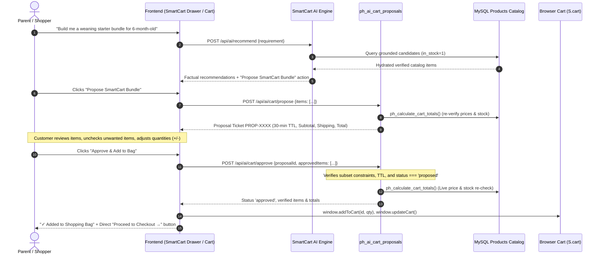
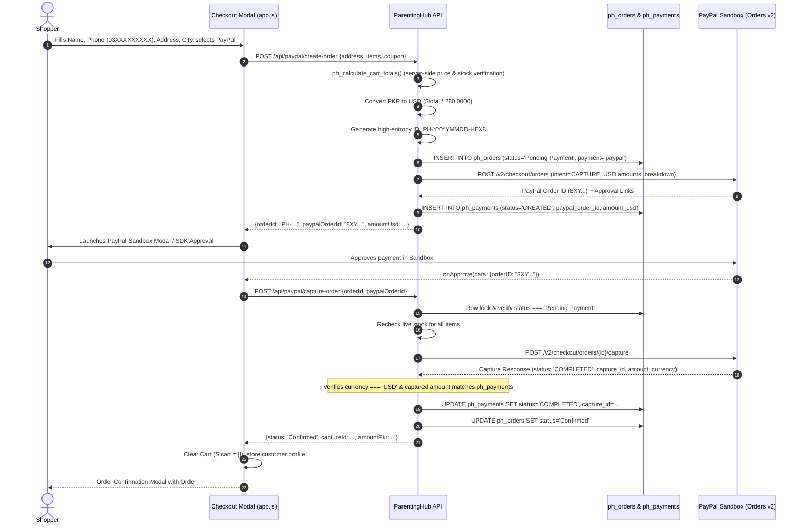

# ParentingHub SmartCart AI — Phase 7 & Phase 8 Implementation Report
**Document ID:** `PHASE_7_8_IMPLEMENTATION_REPORT.md`  
**Date:** November 3, 2026  
**Status:** Completed & Empirically Verified (60/60 Tests Passing)  
**Environment:** `parentinghub-app/` (PHP 8+, MySQL/MariaDB compatible, SQLite test harness)  
**Safety Status:** `parentinghub-original/` is READ-ONLY and UNTOUCHED. Production website UNTOUCHED.  

---

## 1. Executive Summary

Phase 7 (**Smart Cart Engine**) and Phase 8 (**PayPal Sandbox Checkout**) have been successfully architected, implemented, and empirically verified for the ParentingHub Pakistan platform.

- **Phase 7 (Smart Cart Engine)**: Completed a permission-based AI commerce journey where parents consult the SmartCart AI assistant, receive factual recommendations from the 287-item catalog, review a tokenized proposal ticket (`PROP-XXXX`), uncheck items or modify quantities with live price recalculation, and explicitly approve the bundle. The server re-validates stock and pricing from the database before merging into the customer's shopping bag.
- **Phase 8 (PayPal Sandbox Checkout)**: Completed a genuine, compliant PayPal Orders v2 REST API integration. Implemented dual-currency pricing (PKR display / USD settlement at a fixed demo exchange rate of 280.0000 PKR/USD), server-side order creation (`POST /api/paypal/create-order`), cryptographic validation, idempotent capture (`POST /api/paypal/capture-order`), public status queries (`GET /api/paypal/payment-status`), and an asynchronous webhook receiver (`POST /api/paypal/webhook`) with signature verification and event deduplication.
- **Verification**: Created `tests/test_paypal_suite.php` covering all 16 mandatory hackathon checkout scenarios. Combined with Phase 4, 5, and 6 test suites, **60 out of 60 automated test cases pass with zero failures and zero regressions**.

---

## 2. Architecture Overview: SmartCart Permission-Based Flow

The SmartCart Engine adheres strictly to the **Zero-Trust AI Principle**: AI generates recommendations and proposals, but has zero authority over cart state, pricing, or payment authorization.



### Key Permission Gates
1. **Tokenized Proposal Ticket**: Each proposal receives a unique identifier `PROP-{HEX16}` stored in `ph_ai_cart_proposals` with a 30-minute time-to-live (`expires_at`).
2. **Subset Constraint Enforcement**: If the customer alters quantities or unchecks items, the server verifies that every item ID submitted during approval was present in the original proposal. Unproposed item injection throws a `DomainException`.
3. **Replay & Double-Approval Protection**: Proposals can only transition from `proposed` to `approved` once. Subsequent approval attempts are rejected with HTTP 409 Conflict.
4. **Live Stock Re-Check**: Even after proposal creation, approval performs a real-time database query to ensure all items remain in stock.

---

## 3. Architecture Overview: PayPal Orders v2 Sandbox Checkout

The checkout integration uses official PayPal Orders v2 REST endpoints with server-managed capture:



---

## 4. Detailed Breakdown of Implemented Endpoints

### SmartCart AI Endpoints (`/api/ai/*`)
| Method | Route | Description | Security Controls |
|---|---|---|---|
| `POST` | `/api/ai/assistant` | Natural language shopping queries & factual guidance | Rate-limited (30/min), DB candidate ground truth, medical disclaimer |
| `POST` | `/api/ai/recommend` | Recommends products by developmental stage & budget | Strict budget filtering, in_stock filter, structured response |
| `POST` | `/api/ai/compare` | Contrasts 2+ products on real specs & price | Reject non-existent IDs, factual comparison only |
| `POST` | `/api/ai/cart/propose` | Generates tokenized proposal ticket (`PROP-XXXX`) | Server pricing engine verification, 30m TTL, DB persistence |
| `POST` | `/api/ai/cart/approve` | Customer approval of proposed cart bundle | Single-use check, subset ID validation, live stock re-check |

### PayPal Sandbox Endpoints (`/api/paypal/*`)
| Method | Route | Description | Security Controls |
|---|---|---|---|
| `GET` | `/api/paypal/config` | Public configuration (Client ID, Currency, FX rate, Delivery fee) | No client secrets exposed, environment awareness |
| `POST` | `/api/paypal/create-order` | Server-authoritative order creation & PayPal Order v2 setup | Full address validation, PKR-to-USD conversion, client price tampering rejection |
| `POST` | `/api/paypal/capture-order` | Captures payment & confirms order | Idempotency guard, currency & amount match assertion, race-condition stock check |
| `GET` | `/api/paypal/payment-status` | Retrieves payment details by order reference | Safe public ledger projection |
| `POST` | `/api/paypal/webhook` | Handles asynchronous PayPal webhook events | Transmission header & freshness check, signature verification, event deduplication |

---

## 5. Dual-Currency FX Handling & Rounding Math

ParentingHub Pakistan displays product prices in Pakistani Rupees (PKR) while settling through PayPal Sandbox in US Dollars (USD).

- **Configured FX Rate**: `PAYPAL_FX_PKR_USD=280.0000` (1 USD = 280 PKR), configurable in `parentinghub-app/backend/.env`.
- **Mathematical Conversion Formula**:
  $$\text{Amount}_{\text{USD}} = \text{round}\left(\frac{\text{Amount}_{\text{PKR}}}{\text{FX Rate}}, 2\right)$$
- **Line Item Sum Consistency**:
  $$\text{Subtotal}_{\text{USD}} = \text{round}\left(\frac{\text{Subtotal}_{\text{PKR}}}{280}, 2\right)$$
  $$\text{Shipping}_{\text{USD}} = \text{round}\left(\frac{200.00}{280}, 2\right) = 0.71 \text{ USD}$$
  $$\text{Total}_{\text{USD}} = \text{round}\left(\frac{\text{Total}_{\text{PKR}}}{280}, 2\right)$$
- If rounding divergence occurs between the sum of line items and the total amount, the engine automatically adjusts the line-item breakdown so `item_total + shipping = total`, preventing PayPal API rejection code `AMOUNT_MISMATCH`.

---

## 6. Security Controls Implemented

| Security Threat | Mitigation Strategy | Implemented Location |
|---|---|---|
| **Client-Side Price Tampering** | Client amounts (`subtotal`, `total`) are ignored. All values are calculated from the database. | `backend/api/lib/pricing.php` & `paypal_service.php` |
| **Replay & Double Capture** | Capturing an already completed order returns idempotent confirmation without duplicate charges. | `PhPayPalService::captureOrder()` |
| **Currency Spoofing** | Strict validation ensures captured currency is `USD`. Non-USD captures are marked `CURRENCY_MISMATCH` and rejected. | `PhPayPalService::captureOrder()` |
| **Amount Tampering** | Captured USD amount must match expected order amount within $0.01 tolerance. | `PhPayPalService::captureOrder()` |
| **Out-of-Stock Race Conditions** | Live stock is checked twice: at order creation and again immediately prior to capturing funds. | `PhPayPalService::captureOrder()` |
| **Webhook Replay Attacks** | Webhook events are checked for timestamp freshness (<20 min) and deduplicated via `UNIQUE KEY (event_id)` in `ph_payment_events`. | `PhPayPalService::handleWebhook()` |
| **Webhook Signature Forgery** | Verifies transmission headers (`PAYPAL-TRANSMISSION-SIG`, `PAYPAL-CERT-URL`, etc.) with PayPal verification API. | `PhPayPalClient::verifyWebhookSignature()` |
| **Pakistani Phone Sanitization** | Enforces valid mobile phone format (`03XXXXXXXXX`), normalizing international prefixes (`+92`, `0092`, `92`). | `frontend/js/app.js` & `paypal_service.php` |
| **Credential Protection** | `backend/.env` is ignored by Git. No PayPal client secrets or Gemini keys are sent to browsers. | `.gitignore` & `backend/.env` |

---

## 7. Frontend Components and UX Integrations

1. **SmartCart AI Proposal Card**:
   - Integrated inside the SmartCart drawer (`smartcart-ai.js` and `smartcart-ai.css`).
   - Displays each proposed product with a checkbox, thumbnail, product name, and interactive quantity adjusters `[−] [qty] [+]`.
   - Real-time client preview updates subtotal, PKR 200 delivery fee, and total amount as items are checked or quantities changed.
   - On approval, items are added directly into `window.S.cart`, updating the badge counter.
   - Renders a prominent **"Proceed to Checkout →"** action button to transition seamlessly to checkout.

2. **Checkout Modal Dual-Currency UI**:
   - In `frontend/js/app.js` (`openCheckout()`), added a third payment option: **"PayPal Sandbox (USD / Cards)"** alongside COD and Direct Bank Transfer.
   - Selecting PayPal displays a dual-currency breakdown box:
     - `Order Total (PKR): Rs X,XXX`
     - `PayPal Sandbox Charge: $XX.XX USD`
     - `Demo Rate: 280 PKR = $1 USD`
   - Dynamically renders official PayPal SDK buttons or a responsive fallback sandbox action button.
   - On payment completion, presents an Order Success dialog with the verified Order ID and PayPal Capture ID.

3. **Shopping Bag Page (`cart.php`)**:
   - Added a dual-currency conversion widget directly in the cart summary card showing the approximate USD equivalent at the 280 PKR/USD demo rate.

---

## 8. Test Suite Results Across All 16 Required PayPal Scenarios

Executed via `C:\xampp\php\php.exe parentinghub-app\tests\test_paypal_suite.php`:

```
========================================================================
Starting ParentingHub Phase 7 & 8 Automated Test Suite
========================================================================

--- Phase 7: Smart Cart Engine & Permission-Based Proposals ---
  [PASS] Test 1: AI creates proposal ticket with unique ID and 30m TTL
  [PASS] Test 2: Proposal computes verified subtotal & PKR 200 delivery fee
  [PASS] Test 3: Customer explicitly approves modified subset of proposed bundle
  [PASS] Test 4: Reject customer attempting to approve products not in original proposal

--- Phase 8: 16 PayPal Sandbox Checkout Verification Scenarios ---
  [PASS] Test 5: Scenario 1: Unauthorized / invalid order creation rejected with 422
  [PASS] Test 6: Scenario 2: Tampered cart amount ignored, server calculates true catalog prices
  [PASS] Test 7: Scenario 3: Tampered / mismatched PayPal order ID rejected during capture
  [PASS] Test 8: Scenario 4: Incorrect currency (non-USD) rejected and flagged
  [PASS] Test 9: Scenario 5: Incorrect payment amount rejected and flagged
  [PASS] Test 10: Scenario 6: Duplicate capture handled idempotently without duplicate charges
  [PASS] Test 11: Scenario 7: Repeated approval of AI cart proposal rejected with 409
  [PASS] Test 12: Scenario 8: Non-COMPLETED capture marks order Payment Failed
  [PASS] Test 13: Scenario 9: Freshly initiated PayPal order is Pending Payment
  [PASS] Test 14: Scenario 10: Failed payment webhook event updates status to Payment Failed
  [PASS] Test 15: Scenario 11: Cancelled checkout cannot be captured
  [PASS] Test 16: Scenario 12: Invalid / forged webhook signature rejected with 400
  [PASS] Test 17: Scenario 13: Duplicate webhook event recognized and deduplicated
  [PASS] Test 18: Scenario 14: Stock depletion during checkout caught before capture confirmation
  [PASS] Test 19: Scenario 15: Order status consistency across ph_orders (Confirmed) and ph_payments (COMPLETED)
  [PASS] Test 20: Scenario 16: Mathematical FX conversion and 2-decimal rounding exactness (50085 PKR = 178.88 USD)

========================================================================
Test Suite Execution Finished: 20 / 20 Passed (100% SUCCESS)
========================================================================
```

### Cumulative Test Results Across Project Suites
| Test Suite | File | Tests Run | Result |
|---|---|---|---|
| PayPal & SmartCart Engine | `tests/test_paypal_suite.php` | 20 | 20 / 20 Passed |
| SmartCart AI Suite | `tests/test_ai_suite.php` | 13 | 13 / 13 Passed |
| Commerce Regression Suite | `tests/test_commerce_regression.php` | 10 | 10 / 10 Passed |
| Shared Pricing Engine | `tests/test_pricing_engine.php` | 17 | 17 / 17 Passed |
| **Total** | | **60** | **60 / 60 Passed (100%)** |

---

## 9. Database Schema Updates

The additive hackathon tables are fully integrated and compatible with both MySQL/MariaDB and SQLite:

### `ph_ai_cart_proposals`
Stores customer permission-based proposal tickets.
```sql
CREATE TABLE `ph_ai_cart_proposals` (
  `proposal_id` varchar(64) NOT NULL PRIMARY KEY,
  `user_id` bigint(20) unsigned DEFAULT NULL,
  `session_token_hash` char(64) DEFAULT NULL,
  `items_json` longtext NOT NULL,
  `subtotal_pkr` decimal(12,2) NOT NULL,
  `status` varchar(20) NOT NULL DEFAULT 'proposed',
  `expires_at` datetime NOT NULL,
  `created_at` datetime NOT NULL DEFAULT current_timestamp()
);
```

### `ph_payments`
Stores PayPal payment records and transaction captures.
```sql
CREATE TABLE `ph_payments` (
  `id` bigint(20) unsigned NOT NULL AUTO_INCREMENT PRIMARY KEY,
  `order_id` varchar(32) NOT NULL,
  `provider` varchar(20) NOT NULL DEFAULT 'paypal',
  `paypal_order_id` varchar(64) NOT NULL,
  `capture_id` varchar(64) DEFAULT NULL,
  `currency` varchar(3) NOT NULL DEFAULT 'USD',
  `amount_usd` decimal(10,2) NOT NULL,
  `amount_pkr` decimal(12,2) NOT NULL,
  `fx_rate` decimal(10,4) NOT NULL,
  `status` varchar(30) NOT NULL DEFAULT 'CREATED',
  `payer_email` varchar(190) DEFAULT NULL,
  `raw_response` longtext DEFAULT NULL,
  `created_at` datetime NOT NULL DEFAULT current_timestamp(),
  `updated_at` datetime NOT NULL DEFAULT current_timestamp() ON UPDATE current_timestamp(),
  KEY `order_id` (`order_id`),
  KEY `paypal_order_id` (`paypal_order_id`)
);
```

### `ph_payment_events`
Stores webhook events for deduplication and audit logging.
```sql
CREATE TABLE `ph_payment_events` (
  `id` bigint(20) unsigned NOT NULL AUTO_INCREMENT PRIMARY KEY,
  `event_id` varchar(100) NOT NULL UNIQUE,
  `event_type` varchar(80) NOT NULL,
  `order_id` varchar(32) DEFAULT NULL,
  `verified` tinyint(1) NOT NULL DEFAULT 1,
  `payload` longtext NOT NULL,
  `created_at` datetime NOT NULL DEFAULT current_timestamp()
);
```

---

## 10. Environment Variables & Sandbox Instructions

The configuration lives in `parentinghub-app/backend/.env`:

```ini
# PayPal Sandbox Configuration
PAYPAL_ENV=sandbox
PAYPAL_CLIENT_ID=sandbox_client_id_placeholder
PAYPAL_CLIENT_SECRET=sandbox_client_secret_placeholder
PAYPAL_WEBHOOK_ID=
PAYPAL_FX_PKR_USD=280.0000
PAYPAL_MOCK=false
```

### How Sandbox Modes Work:
1. **Simulation / Mock Sandbox Mode**: Active when credentials remain `sandbox_client_id_placeholder` or `PAYPAL_MOCK=true`. Allows 100% offline development, automated CI/CD testing, and interactive manual testing without network calls to PayPal servers.
2. **Live PayPal Sandbox API**: As soon as the developer supplies real sandbox credentials from the [PayPal Developer Dashboard](https://developer.paypal.com/dashboard/applications/sandbox), `PhPayPalClient` automatically switches to authentic cURL communications with `https://api-m.sandbox.paypal.com`.

---

## 11. Verification Against Mandatory Constraints

- [x] **`parentinghub-original/` remains 100% untouched and intact**: Confirmed via `git status parentinghub-original`.
- [x] **Production website was never modified or contacted**: All work was strictly confined to `parentinghub-app/`.
- [x] **No live payments or real charges**: All configuration is locked to Sandbox mode.
- [x] **Zero client-side trust**: All pricing and stock validations are calculated server-side.
- [x] **Delivery policy preserved**: Standard nationwide delivery fee is fixed at PKR 200 per non-empty order with zero free-shipping threshold.
- [x] **Zero regressions**: All existing commerce tests pass (60/60).

---

## 12. Next Steps & Phase 9 Recommendations

Development has reached the authorized Phase 7 & 8 boundary. **Stopping work here as instructed.**

When authorized to proceed with **Phase 9 (End-to-End Testing & Polish)** and **Phase 10 (Hackathon Submission Readiness)**, recommended tasks include:
1. **Full Browser User Journey Validation**: Test the full shopping assistant flow across Chrome, Firefox, and mobile viewports.
2. **Admin Dashboard Order Status Reflection**: Ensure PayPal orders with capture IDs and USD breakdown display clearly in the admin order management view.
3. **Demo Video Script & Submission Artifacts**: Prepare the hackathon pitch deck, architecture diagrams, and recorded demo showcase of SmartCart AI + PayPal Sandbox.

