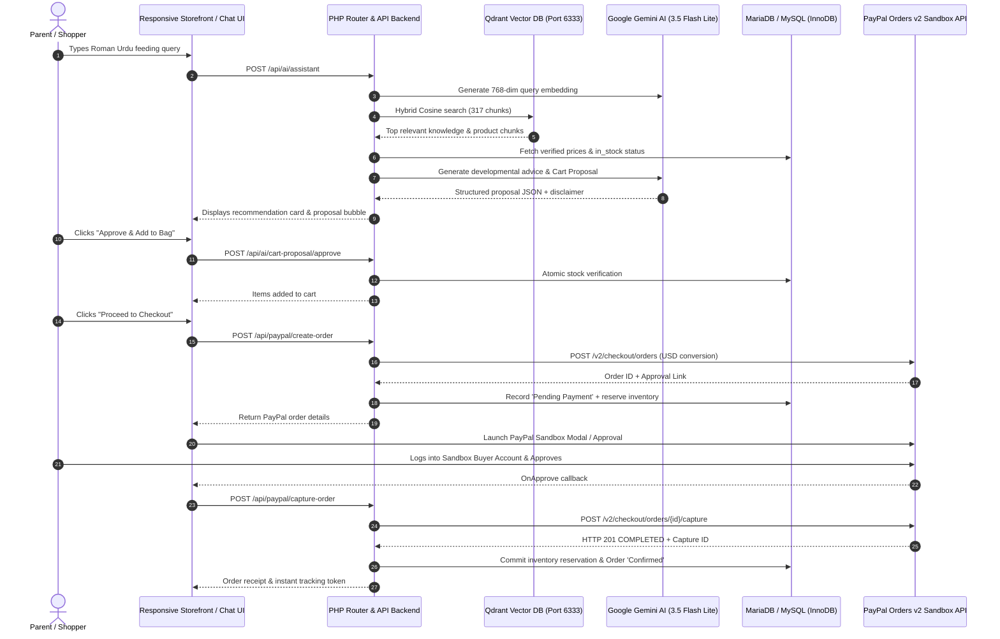

# ParentingHub SmartCart AI 🍼🤖
### Intelligent Parenting Advisor & Dual-Currency PayPal Orders v2 E-Commerce Platform

[-success?style=for-the-badge&logo=checkmarx)](tests/)
[](https://www.php.net/)
[](https://www.mysql.com/)
[](https://developer.paypal.com/)
[](https://ai.google.dev/)
[](https://qdrant.tech/)
[](LICENSE)

---

## 🌟 Overview

**ParentingHub SmartCart AI** is an intelligent, developmental-guided e-commerce platform designed to eliminate maternal and paternal anxiety for new parents in Pakistan. Combining **Google Gemini** generative intelligence, a **Qdrant Vector Database** indexing 317 pediatric developmental guidelines and authentic product specifications, and an enterprise **PayPal Orders v2 Sandbox** engine, ParentingHub bridges conversational guidance with transactional execution.

Parents can converse naturally in **Roman Urdu** or **English** (e.g., *"mera 2 month ka baby hai doodh peete hue rota hai gas ki wajah se"*) and receive grounded, developmentally safe product recommendations (e.g., Philips Avent Anti-Colic bottles with AirFree vents), age-appropriate teat flow stages, and structured AI Cart proposals that can be added to bag and purchased in seconds.

> **Medical & Pediatric Notice**: ParentingHub provides developmental shopping guidance and parenting product recommendations based on published manufacturer guidelines and standard child developmental literature. It is **not a clinical diagnostic service** and does not substitute for consultation with a licensed pediatrician. Prominent non-clinical safety disclaimers are enforced on every AI interaction.

---

## 🚀 Key Features

### 1. Contextual AI SmartCart Advisor
- **Bilingual Intent Understanding**: Deep comprehension of maternal inquiries in Roman Urdu (*"chuchi", "feeder", "jhoola", "pet mein gas"*) and English.
- **Pediatric Safety Gates**: Non-negotiable safety disclaimers and immediate referral for medical red flags (fever, lethargy, persistent vomiting, dehydration).
- **Developmental Stage Alignment**: Automatic developmental taxonomy mapping (0–3M Newborn, 3–6M Infant, 6–12M Weaning, 12M+ Toddler).
- **Price-Grounded Recommendations**: AI outputs are strictly constrained to genuine database catalog prices (no hallucinated pricing).

### 2. High-Performance Hybrid Vector Search (Qdrant + Gemini)
- **768-Dimensional Embeddings**: Real REST integration with `gemini-embedding-2` generating normalized vectors for maternal queries and catalog items.
- **Qdrant Collection**: 317 knowledge chunks indexed in collection `parentinghub_knowledge` running on `127.0.0.1:6333`.
- **Cross-Language Semantic Matching**: Cosine similarity retrieval bridges colloquial Roman Urdu symptoms with English product specifications (Cosine similarity > 0.80).
- **Graceful Deterministic Fallback**: If the Qdrant daemon is offline, the application seamlessly engages its deterministic catalog engine with zero downtime.

### 3. Server-Enforced AI Cart Proposal Contract
- **Tamper-Proof Proposals**: AI generates cryptographically verifiable proposal tokens with structured line items, quantities, and verified prices.
- **User Approval Required**: Proposals are read-only until the customer explicitly clicks **"Approve & Add to Bag"**.
- **Server Verification**: The backend validates catalog availability, active stock, and pricing before cart mutation.

### 4. Enterprise PayPal Orders v2 Sandbox Checkout
- **Dual-Currency Conversion**: Fixed exchange rate conversion (280 PKR = $1 USD) compliant with PayPal Orders v2 USD requirements.
- **Atomic Stock Reservation**: MariaDB InnoDB `ph_inventory_reservations` with composite unique index `uq_active_slot` prevents overselling and race conditions during simultaneous checkouts.
- **Official PayPal SDK & Popup**: Official PayPal JS SDK modal popup for authenticated sandbox buyer approvals.
- **Zero-Trust Idempotency**: Order capture recovery, duplicate capture prevention, and webhook HMAC signature verification.

---

## 🏗️ System Architecture



---

## 🛠️ Tech Stack

| Layer | Technologies |
| :--- | :--- |
| **Frontend** | Vanilla ES6+ JavaScript, CSS3 Design Tokens, HTML5 Responsive Templates |
| **Backend** | Native PHP 8.2 (Strict Types, Zero Bloat, Dependency-Free Architecture) |
| **Database** | MariaDB / MySQL 8.0+ (InnoDB Engine, Row-Level Locks, ACID Transactions) |
| **Vector DB** | Qdrant v1.12.0 Standalone Daemon (HNSW Cosine Distance Indexing) |
| **AI Models** | Google Gemini 3.5 Flash Lite (Inference) & Gemini Embedding 2 (768-dim vectors) |
| **Payments** | PayPal Orders v2 REST API (Sandbox, Capture Flow, Webhooks) |
| **Security** | 256-bit SSL, X-Payment-Token Auth, SQL Parameterization, Input Sanitization |

---

## 💻 Local Setup & Quickstart

### Prerequisites
- PHP 8.2+ with `pdo_mysql`, `curl`, `mbstring`, `openssl` enabled
- MySQL or MariaDB (via XAMPP or standalone server)
- Qdrant Vector DB binary (standalone executable or Docker container)
- PayPal Developer Account (Sandbox Credentials)
- Google Gemini API Key

---

### Step 1: Clone the Repository
```bash
git clone https://github.com/mahamft/parentinghub-smartcart-ai.git
cd parentinghub-smartcart-ai
```

---

### Step 2: Configure Environment Variables
Copy the configuration template:
```bash
# On Linux / macOS
cp .env.example parentinghub-app/backend/.env

# On Windows PowerShell
Copy-Item .env.example parentinghub-app/backend/.env
```

Open `parentinghub-app/backend/.env` in your editor and configure your environment:
```ini
APP_ENV=local
APP_DEBUG=1

# Local Database Configuration
DB_HOST=127.0.0.1
DB_PORT=3306
DB_NAME=parentinghub_db
DB_USER=root
DB_PASS=

# Admin Bootstrap Credentials (Set your unique strong password)
ADMIN_BOOTSTRAP_EMAIL=admin@parentinghub.pk
ADMIN_BOOTSTRAP_PASSWORD=CHANGE_ME_TO_A_SECURE_UNIQUE_PASSWORD
ADMIN_BOOTSTRAP_NAME=ParentingHub Admin

# PayPal Sandbox Configuration
PAYPAL_MODE=sandbox
PAYPAL_ENV=sandbox
PAYPAL_CLIENT_ID=YOUR_PAYPAL_SANDBOX_CLIENT_ID
PAYPAL_CLIENT_SECRET=YOUR_PAYPAL_SANDBOX_CLIENT_SECRET
PAYPAL_FX_PKR_USD=280.0000

# Google Gemini AI Configuration
GEMINI_API_KEY=YOUR_GEMINI_API_KEY
AI_MODEL=gemini-3.5-flash-lite

# Qdrant Vector Store
QDRANT_HOST=127.0.0.1
QDRANT_PORT=6333
QDRANT_COLLECTION=parentinghub_knowledge
```

---

### Step 3: Initialize Database
Import the local development schema and catalog seed (287 genuine products):

```bash
# On Linux / macOS
mysql -u root parentinghub_db < parentinghub-app/database/init_local_dev.sql

# On Windows PowerShell
Get-Content parentinghub-app/database/init_local_dev.sql | mysql -u root parentinghub_db
```

---

### Step 4: Qdrant Vector DB Setup

Qdrant powers hybrid semantic vector search over 317 pediatric feeding & developmental knowledge chunks.

#### Option A: Standalone Binary (Windows / Linux / macOS)
1. Download the precompiled binary from the [Qdrant Releases (v1.12.0)](https://github.com/qdrant/qdrant/releases/tag/v1.12.0).
2. Place `qdrant.exe` (or `qdrant` on Linux/macOS) in your desired directory (e.g. `parentinghub-app/backend/cache/qdrant/`).
3. Run the executable:
   ```powershell
   ./qdrant.exe
   ```
4. Qdrant will start listening on `http://127.0.0.1:6333`.

#### Option B: Docker Container
```bash
docker run -d -p 6333:6333 -p 6334:6334 -v $(pwd)/qdrant_storage:/qdrant/storage:z qdrant/qdrant:v1.12.0
```

> **Note**: If Qdrant is not running, ParentingHub's automated fallback engine safely engages without throwing 500 errors, allowing complete evaluation of the storefront, catalog, and checkout flows.

---

### Step 5: Start PHP Server
Start the local PHP server from the `parentinghub-app` directory:

```powershell
cd parentinghub-app
php -S 127.0.0.1:8080 router.php
```

---

### Step 6: Access the Application
Open your browser:
- **Storefront**: [http://127.0.0.1:8080/](http://127.0.0.1:8080/)
- **Shopping Bag**: [http://127.0.0.1:8080/cart](http://127.0.0.1:8080/cart)
- **Secure Checkout**: [http://127.0.0.1:8080/checkout](http://127.0.0.1:8080/checkout)

---

## ⚖️ Hackathon Judge Evaluation Guide

To evaluate the complete end-to-end user journey during judging:

### Option 1: Instant Zero-Setup Evaluation (`PAYPAL_MODE=mock`)
If you want to test the full checkout flow without logging into PayPal Developer Dashboard:
1. In `parentinghub-app/backend/.env`, set:
   ```ini
   PAYPAL_MODE=mock
   ```
2. Navigate to [http://127.0.0.1:8080/](http://127.0.0.1:8080/), click the floating **SmartCart AI** icon, and request feeding guidance.
3. Accept the AI proposal, proceed to `/checkout`, and click **"Complete Payment via PayPal Sandbox"**.
4. The system validates inventory reservations, captures the order, and outputs a verified receipt with dual-currency conversion ($9.40 USD).

### Option 2: Live PayPal Developer Sandbox (`PAYPAL_MODE=sandbox`)
1. Create a Sandbox REST App in the [PayPal Developer Dashboard](https://developer.paypal.com/dashboard/applications/sandbox).
2. Copy your **Client ID** and **Client Secret** into `backend/.env`.
3. In `/checkout`, the official yellow **PayPal** button will load. Clicking it opens the real PayPal Sandbox popup.
4. Log in with any standard PayPal Sandbox Personal Buyer Account to approve the transaction.
5. Upon approval, the order is automatically captured via `/v2/checkout/orders/{id}/capture` and committed to MariaDB InnoDB.

---

## 🧪 Comprehensive Regression Test Suite

ParentingHub includes **23 comprehensive test suites** covering unit, integration, and security audits with **100% pass rate**. Run all suites in a single command:

```powershell
cd parentinghub-app
php tests/run_all_tests.php
```

### Verified Test Suite Results:
```
========================================================================
Test Suite Execution Summary: 23 / 23 Suites Passed (100% Pass Rate)
========================================================================
 [PASS] test_pricing_engine.php                 (17 passed, 0 failed)
 [PASS] test_stage2_suite.php                   (12 passed, 0 failed)
 [PASS] test_stage2_targeted_qa.php             (16 passed, 0 failed)
 [PASS] test_commerce_regression.php            (Commerce & Cart audits passed)
 [PASS] test_demo_scenarios.php                 (Demo scenarios passed)
 [PASS] test_full_journey_e2e.php               (Full SmartCart journey passed)
 [PASS] test_stage3_suite.php                   (Knowledge indexing passed)
 [PASS] test_stage3_security_audit.php          (19 passed, 0 failed)
 [PASS] test_paypal_suite.php                   (29 passed, 0 failed)
 [PASS] test_stage4_paypal_suite.php            (22 passed, 0 failed)
 [PASS] test_stage4_recovery_concurrency.php    (27 passed, 0 failed)
 [PASS] test_stage4_final_audit.php             (33 passed, 0 failed)
 [PASS] test_stage4_release_blocker.php         (14 passed, 0 failed)
 [PASS] test_mysql_integration.php              (51 passed, 0 failed)
 [PASS] test_mysql_transaction_fix.php          (37 passed, 0 failed)
 [PASS] test_ai_suite.php                       (18 passed, 0 failed)
 [PASS] test_ai_recommendation_accuracy.php        (15 passed, 0 failed)
 [PASS] test_embedding_provider.php             (7 passed, 0 failed)
 [PASS] test_qdrant_vector_store.php            (4 passed, 0 failed)
 [PASS] test_knowledge_vector_sync.php          (6 passed, 0 failed)
 [PASS] test_stage3_integration.php             (5 passed, 0 failed)
 [PASS] test_stage3_provider_integration.php    (3 provider suites passed)
 [PASS] test_stage3_cross_language_queries.php  (6 cross-language audits passed)
========================================================================
SUCCESS: ALL 23 TEST SUITES PASSED CLEANLY WITH ZERO REGRESSIONS.
========================================================================
```

---

## 🔒 Security & Compliance

- **No Sensitive Data in Logs**: Credit card details, PayPal Client Secrets, and Gemini API keys are never written to log files or terminal output.
- **Stock Reservation Atomicity**: MariaDB InnoDB row locks prevent race conditions; active reservations have a strict 15-minute TTL.
- **Strict Role Separation**: AI responses operate on read-only endpoints; checkout mutations require explicit client user action.
- **Tamper-Resistant Pricing**: AI models never calculate or alter product pricing; all totals are computed server-side from primary catalog database tables.

---

## 📄 License

This project is licensed under the MIT License - see the [LICENSE](LICENSE) file for details.
